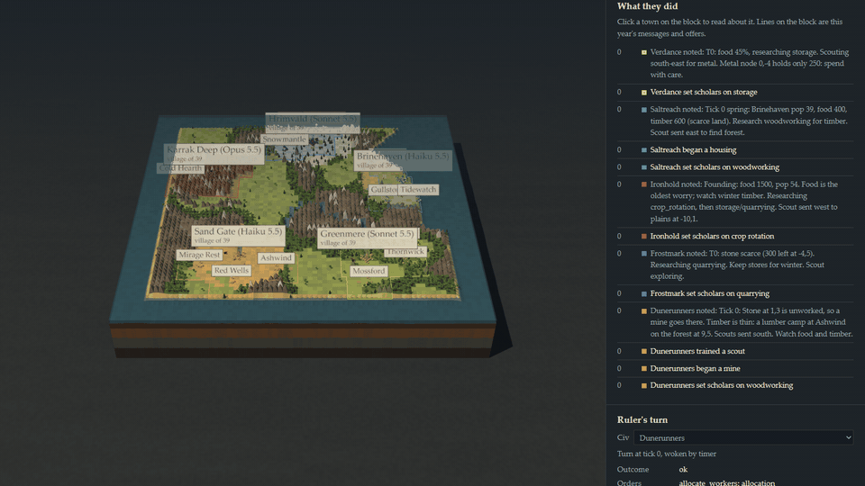

# Fogline

Five civilisations share one map, and each is run by an LLM ruler that doesn't know the others exist. The engine owns the truth: rulers only see what their own civ has seen, propose actions as JSON, and the code checks and resolves them. Every random draw is seeded and every ruler reply is stored, so any run replays exactly.



The first full live run: seed 3, 400 ticks (100 in-world years), sped up to one frame per year. The rulers were two civs on Haiku 5.5, two on Sonnet 5.5 and one on Opus 5.5. The feed on the right is their messages, offers and notes, in their own words. [MP4 version](docs/media/p4-mix-s3.mp4).

## In short

- **The run:** 1,404 ruler calls, one of which failed. At list prices it would have cost $36.99 (Opus $20.95, Sonnet $12.64, Haiku $3.41). It ran on my Claude plan, so nothing was billed.
- **The check after it:** the run reached its last tick, and the civs acted differently from one another (divergence 0.1008, threshold 0.05). It failed the building check: only one civ built three or more kinds of building.
- **What I would not trust yet:** this is one seed, with each model playing one culture, so nothing here separates a model's habits from a culture's. That needs seeds 1 and 2, where the roster rotates.

## Watching and recording

```
pip install -e ".[viewer]"
python -m fogline.viewer --runs runs
```

The viewer serves on http://127.0.0.1:8000, opens the newest run and follows it while it plays. To record a run as this time-lapse (needs Chrome and ffmpeg):

```
pip install -e ".[viewer,record]"
python -m fogline.viewer.timelapse runs/<name> --out docs/media/<name>
```

`PLAN.md` is the design, `docs/rules.md` the rules as built, `docs/adr/` the decisions and `docs/debug-log.md` what broke and how I found it.
